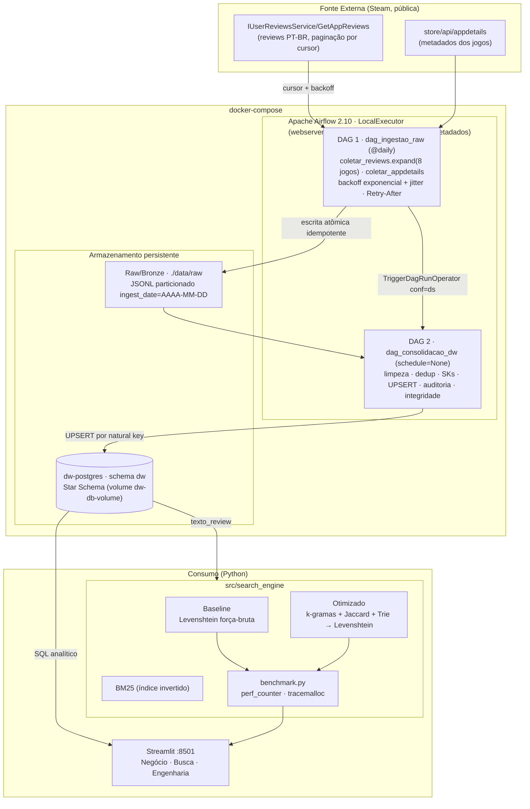
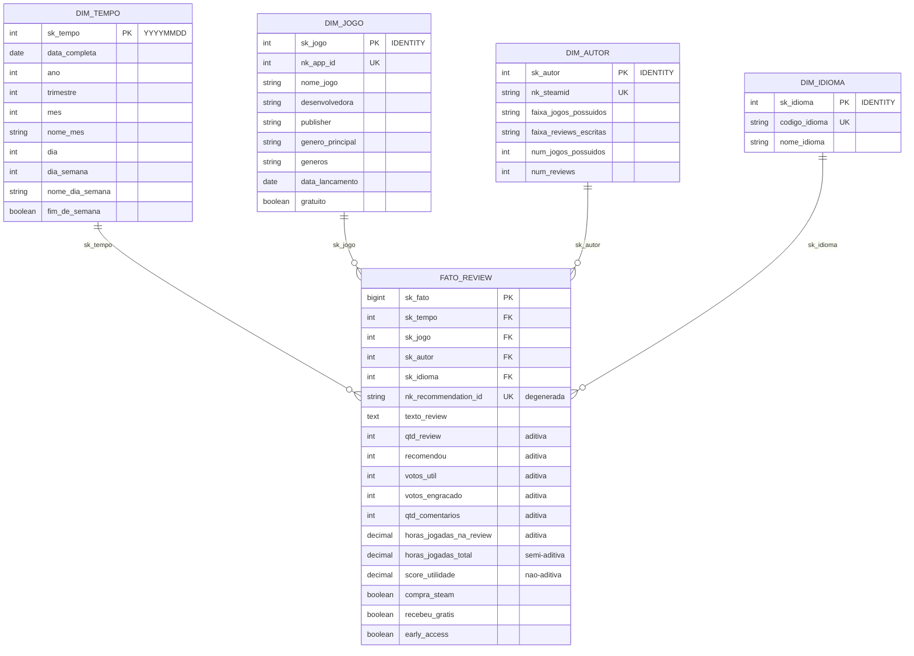
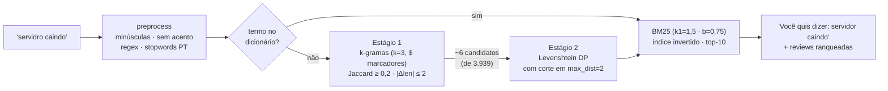

# 🎮 Steam Reviews Intelligence — T2 FUCAPE

Pipeline de dados conteinerizado (Airflow → Raw JSONL → Star Schema de Kimball) com painel executivo e **busca textual tolerante a erros de digitação**, sobre reviews de jogos da Steam escritas em português do Brasil.

---

## 1. Identificação

| | |
|---|---|
| **Integrantes** | Matheus Teixeira do Carmo Emerich · Guilherme Bazani |
| **Curso** | Ciência de Dados para Negócios — FUCAPE Business School |
| **Disciplinas** | Modelagem Informacional · PLN e Sistemas de Recuperação de Informação |
| **Docente** | Prof. Dr. Wagner Perin |
| **Tema** | Inteligência sobre a percepção dos jogadores: reviews da Steam |
| **Técnica de RI** | **Opção 3:** busca tolerante a falhas com correção ortográfica em 2 estágios (k-gramas + Jaccard + Trie → Levenshtein) e ranqueamento BM25 |

## 2. Contexto de negócio e dor

Estúdios e publishers recebem **milhares de reviews em texto livre** por semana. O time de produto não consegue acompanhar a percepção dos jogadores nem achar rápido as reclamações recorrentes: "bug", "travando", "otimização", "servidor", "hacker". Para piorar, quem escreve review digita com pressa e com erro ("otimizasao", "servidro", "travano"), e uma busca exata simplesmente não encontra esses textos.

O projeto entrega:

- **um Data Warehouse dimensional** com KPIs de percepção (taxa de recomendação, volume ao longo do tempo, horas jogadas, utilidade das reviews), filtráveis por jogo, gênero, período e perfil do autor;
- **uma busca textual rápida e tolerante a erros**, que corrige a consulta ("Você quis dizer: *servidor caindo*") e ranqueia as reviews por relevância (BM25);
- **uma esteira automatizada, resiliente e idempotente**, que roda todo dia sem duplicar dados.

**Por que a Steam?** A fonte é pública e sem chave, tem volume grande (milhões de reviews), texto rico em PT-BR e metadados estruturados (jogo, gênero, horas jogadas, votos), o que dá base tanto para modelagem dimensional quanto para RI. Corpus atual: **~16 mil reviews** de 8 jogos populares no Brasil (CS2, Dota 2, GTA V, Apex Legends, PUBG, Rust, Elden Ring e Stardew Valley).

## 3. Arquitetura de Engenharia de Dados



Mais detalhes em [`docs/arquitetura.md`](docs/arquitetura.md).

> **Nota sobre a fonte:** o endpoint antigo `store.steampowered.com/appreviews` foi descontinuado e hoje responde com redirect 302. Usamos o substituto oficial `IUserReviewsService/GetAppReviews`, que também é público e sem chave, com os mesmos campos e a mesma paginação por cursor.

### 3.1 Resiliência da ingestão

| Aspecto | Como foi tratado |
|---|---|
| **Paginação** | por **cursor**: começa com `*` e repassa o `cursor` de cada resposta. Para quando a lista vem vazia, o cursor vem nulo, o cursor se **repete** (proteção contra loop) ou chega ao limite `STEAM_MAX_PAGES` (20 páginas × 100 = 2.000 reviews por jogo) |
| **Códigos HTTP tratados** | `429` (rate limit) e `500/502/503/504` → retentativa. `Timeout` e `ConnectionError` → retentativa. Outros `4xx` e JSON inválido → falha imediata (repetir não resolve) |
| **Exponential backoff + jitter** | `espera = min(base · 2^tentativa, 60 s) + U(0, 1)`, com até 5 tentativas. O jitter espalha as retentativas e evita picos sincronizados |
| **`Retry-After`** | quando o servidor envia o cabeçalho, ele tem prioridade sobre o cálculo |
| **Polidez** | 1 s entre páginas e no máximo 2 jogos coletados ao mesmo tempo (`max_active_tis_per_dagrun=2`) |
| **2ª camada (Airflow)** | `retries=3`, `retry_exponential_backoff=True`, `max_retry_delay=10 min` |
| **Demonstração** | `STEAM_SIMULATE_429_RATE=0.2` no `.env` injeta 429 simulados. O log da task mostra `[RETRY 1/5] ... -> HTTP 429 ... Aguardando 1.52s (backoff exponencial + jitter)` |

### 3.2 Demonstração formal da idempotência

**DAG 1 (Raw).** Cada execução escreve `data/raw/steam_reviews/ingest_date={ds}/app_id={id}.jsonl` num arquivo temporário e faz `os.replace` (rename atômico), **sobrescrevendo** a partição do dia. As reviews são deduplicadas por `recommendationid` dentro da execução. Logo, `f(f(x)) = f(x)`: reexecutar o mesmo `ds` deixa a partição com o mesmo número de arquivos e nenhuma linha duplicada.

Evidência real ([`docs/prova_idempotencia_dag1.txt`](docs/prova_idempotencia_dag1.txt)), com *Clear* das 8 tasks `coletar_reviews` do mesmo `ds`:

| | Arquivos na partição | Linhas por jogo | IDs únicos por jogo |
|---|---:|---:|---:|
| Antes do Clear | 16 | 2.000 | 2.000 |
| Depois da reexecução | 16 | 2.000 | 2.000 (substituídas, não somadas) |

**DAG 2 (DW).** Dimensões e fato usam **UPSERT pela chave natural** (`ON CONFLICT (nk) DO UPDATE`), e `fato_review.nk_recommendation_id` é `UNIQUE`. Uma segunda carga da mesma partição só atualiza linhas e não insere nenhuma, então as métricas não inflam. Evidência gerada por [`scripts/prova_idempotencia.sh`](scripts/prova_idempotencia.sh) ([saída completa](docs/prova_idempotencia_saida.txt)):

| Momento | linhas | nks distintas | Σ qtd_review | Σ recomendou | Σ votos_util | Σ horas_na_review | autores |
|---|---:|---:|---:|---:|---:|---:|---:|
| Antes | 15.962 | 15.962 | 15.962 | 14.153 | 6.145 | 9.736.164,96 | 15.830 |
| Após 1ª execução da DAG 2 | 15.962 | 15.962 | 15.962 | 14.153 | 6.145 | 9.736.164,96 | 15.830 |
| Após 2ª execução da DAG 2 | 15.962 | 15.962 | 15.962 | 14.153 | 6.145 | 9.736.164,96 | 15.830 |

Auditoria das duas execuções: `linhas_inseridas = 0` e `linhas_atualizadas = 15.914` nas duas, status `success`.

Além disso, a task `validar_integridade` (última da DAG 2) checa **FK órfã** em cada dimensão, **nk duplicada** na fato e `qtd_review ≠ 1`. Se encontrar qualquer problema, marca a auditoria como `integrity_failed` e falha a DAG.

## 4. Modelagem Dimensional

> **Granularidade da fato:** *cada linha da `fato_review` representa uma review publicada por um usuário da Steam sobre um jogo, na data de criação da review.*



**Surrogate keys:** todas inteiras. `sk_jogo`, `sk_autor` e `sk_idioma` são `INTEGER GENERATED ALWAYS AS IDENTITY`, geradas pelo banco e desacopladas das natural keys (`nk_app_id`, `nk_steamid`, `codigo_idioma`). `sk_tempo` é a *smart key* `YYYYMMDD` que Kimball recomenda para a dimensão data. A fato só referencia SKs, com FKs `REFERENCES`.

### Dicionário resumido

| Métrica / atributo | Tabela | Classificação | Papel |
|---|---|---|---|
| `qtd_review` | fato | **Aditiva** | sempre 1, então `SUM` = nº de reviews |
| `recomendou` | fato | **Aditiva** | 0/1, então `SUM` = nº de recomendações |
| `votos_util`, `votos_engracado`, `qtd_comentarios` | fato | **Aditivas** | engajamento da review |
| `horas_jogadas_na_review` | fato | **Aditiva** | horas quando a review foi escrita |
| `horas_jogadas_total` | fato | **Semi-aditiva** | snapshot acumulado do autor: soma entre autores, mas não ao longo do tempo para o mesmo autor |
| `score_utilidade` | fato | **Não-aditiva** | `weighted_vote_score` (0–1), usar `AVG` |
| taxa de recomendação | derivada | **Não-aditiva** | `SUM(recomendou) / SUM(qtd_review)` |
| `nk_recommendation_id` | fato | Dimensão degenerada | chave de negócio da linha, usada no UPSERT |
| `dim_tempo` | dimensão | Calendário contínuo | ano, trimestre, mês, dia, dia da semana, fim de semana |
| `dim_jogo` | dimensão | Produto | nome, desenvolvedora, publisher, gêneros, lançamento, gratuito |
| `dim_autor` | dimensão (SCD 1) | Cliente | steamid e faixas de experiência (nº de reviews escritas) |
| `dim_idioma` | dimensão | Idioma | código e nome do idioma |

Dicionário completo, explicação das SKs e exemplos de SQL em [`docs/modelo_dimensional.md`](docs/modelo_dimensional.md).

## 5. Inteligência de Recuperação de Informação

**Técnica escolhida: Opção 3, busca tolerante a falhas e correção ortográfica em 2 estágios.** Também usamos BM25 para ranquear os resultados.

### 5.1 Pipeline de uma consulta



- **Pré-processamento** ([`preprocess.py`](src/search_engine/preprocess.py)): minúsculas, remoção de acentos com `unicodedata` (NFKD), tokens `[a-z0-9]+`, lista própria de stopwords em PT-BR (sem download) e descarte de tokens com menos de 2 caracteres.
- **Dicionário de correção:** termos do corpus com frequência ≥ 5 (3.939 de 17.419). Termos raros costumam ser os próprios erros, então não podem ser "palavras corretas".
- **Estágio 1: índice secundário de k-gramas** ([`kgram.py`](src/search_engine/kgram.py)). Cada termo vira trigramas com marcadores, por exemplo `servidor` → `{$se, ser, erv, rvi, vid, ido, dor, or$}`. O índice invertido `k-grama → [termos]` permite fazer o merge só das listas dos k-gramas da consulta e calcular o **coeficiente de Jaccard** `J = |A∩B| / (|A| + |B| − |A∩B|)`. Ficam os termos com `J ≥ 0,2` e diferença de comprimento ≤ 2. Esse filtro é seguro porque `Levenshtein(a, b) ≥ ||a| − |b||`.
- **Trie** ([`trie.py`](src/search_engine/trie.py)): autocompletar da caixa de busca. Chegar ao nó do prefixo custa **O(|P|)**, e cada nó guarda as top-8 palavras mais frequentes da subárvore, pré-computadas, então a sugestão também sai em O(|P|).
- **Estágio 2: distância de Levenshtein** ([`levenshtein.py`](src/search_engine/levenshtein.py)), por programação dinâmica implementada à mão (`D[i][j] = min(D[i−1][j]+1, D[i][j−1]+1, D[i−1][j−1]+[aᵢ≠bⱼ])`, com duas linhas, memória O(min(|a|,|b|))). É aplicada **só aos candidatos** e tem **corte antecipado**: se o mínimo de uma linha passa de `max_dist`, o cálculo para.
- **Escolha da correção** (igual nos dois métodos): menor distância ≤ 2. No empate vence o termo mais frequente no corpus e, depois, a ordem alfabética.
- **Ranqueamento BM25** ([`bm25.py`](src/search_engine/bm25.py)): índice invertido `termo → [(doc, tf)]`, `IDF = ln(1 + (N − df + 0,5)/(df + 0,5))`, normalização por tamanho do documento, `k1 = 1,5` e `b = 0,75`. Os top-10 saem por `heapq.nlargest`.

### 5.2 Linha de base (Antes)

[`baseline.py`](src/search_engine/baseline.py): **Levenshtein em força-bruta**. Para cada termo fora do dicionário, calcula a distância completa (a mesma DP, sem corte) contra **todo o vocabulário** de correção, ou seja, 3.939 comparações por termo, custo `O(|V| · |q| · |t|)`. O critério de escolha é o mesmo do otimizado, então os dois devem dar a **mesma correção**, e o benchmark mede essa concordância.

## 6. Resultados experimentais

Fonte: [`docs/benchmark_resultados.md`](docs/benchmark_resultados.md) / [`.csv`](docs/benchmark_resultados.csv), gerados por `python -m search_engine.benchmark`. Corpus de **15.962 reviews**, vocabulário de **17.419** termos, dicionário de correção de **3.939** termos. Cada consulta teve 1 aquecimento + **20 repetições** cronometradas com `time.perf_counter()`, mostradas como média ± desvio padrão. Medição feita no contêiner `streamlit` (Python 3.11). O tempo medido é o da **etapa de correção**, que é onde a técnica atua.

| Consulta | Correção | Baseline (ms) | Otimizado (ms) | Δ% | Speedup | Comparações evitadas |
|---|---|---:|---:|---:|---:|---:|
| `otimizasao` | otimizacao | 77.69 ± 16.16 | 0.142 ± 0.070 | 99.82% | 548.3× | 99.92% |
| `travano` | travado | 41.96 ± 1.87 | 0.157 ± 0.059 | 99.63% | 267.0× | 99.82% |
| `servidro` | servidor | 54.63 ± 11.69 | 0.125 ± 0.034 | 99.77% | 436.0× | 99.85% |
| `hackr` | hack | 38.67 ± 6.62 | 0.044 ± 0.006 | 99.89% | 888.7× | 99.90% |
| `lagadno` | lagado | 67.11 ± 25.99 | 0.033 ± 0.004 | 99.95% | 2055.7× | 99.97% |
| `graficso ruim` | grafico ruim | 53.50 ± 7.88 | 0.092 ± 0.054 | 99.83% | 583.4× | 99.92% |
| `multiplayr` | multiplayer | 64.17 ± 14.80 | 0.159 ± 0.031 | 99.75% | 402.5× | 99.95% |
| `atualisacao` | atualizacao | 86.27 ± 17.75 | 0.222 ± 0.041 | 99.74% | 389.1× | 99.82% |
| `bugado demias` | bugado demais | 42.15 ± 4.86 | 0.161 ± 0.058 | 99.62% | 261.6× | 99.75% |
| `dificil dmeais` | dificil dmais | 42.35 ± 5.21 | 0.172 ± 0.083 | 99.59% | 245.6× | 99.72% |
| `jogabilidadde` | jogabilidade | 82.44 ± 6.40 | 0.209 ± 0.163 | 99.75% | 393.9× | 99.85% |
| `pessimo suprote` | pessimo suporte | 74.42 ± 20.97 | 0.124 ± 0.017 | 99.83% | 599.3× | 99.90% |
| `comunidadde toxica` | comunidade toxica | 110.71 ± 27.54 | 0.294 ± 0.090 | 99.73% | 376.2× | 99.75% |
| `viciamte` | viciante | 54.13 ± 4.12 | 0.173 ± 0.028 | 99.68% | 312.2× | 99.80% |
| `trapasa` | trapaca | 54.69 ± 9.89 | 0.145 ± 0.011 | 99.74% | 377.9× | 99.77% |
| `histroia incrivel` | historia incrivel | 50.07 ± 5.15 | 0.110 ± 0.011 | 99.78% | 455.0× | 99.85% |
| `desempneho` | desempenho | 48.89 ± 1.33 | 0.082 ± 0.010 | 99.83% | 599.0× | 99.95% |
| `chetaers` | cheaters | 55.23 ± 9.78 | 0.043 ± 0.003 | 99.92% | 1298.9× | 99.97% |
| `precço alto` | preco alto | 68.90 ± 21.93 | 0.284 ± 0.096 | 99.59% | 242.9× | 99.59% |
| `otmizado` | otimizado | 67.09 ± 12.33 | 0.276 ± 0.122 | 99.59% | 243.0× | 99.85% |

| Métrica global | Valor |
|---|---:|
| **T_antes** (média, baseline) | **61,75 ms** |
| **T_depois** (média, otimizado) | **0,152 ms** |
| **Δ% = (T_antes − T_depois) / T_antes × 100** | **99,75%** |
| **Speedup = T_antes / T_depois** | **405×** |
| Comparações de Levenshtein evitadas (poda) | **99,85%** |
| Concordância das correções (baseline = otimizado) | **100%** (20/20) |
| Memória das estruturas (`tracemalloc`): baseline / otimizado | 0,13 MB / 4,10 MB |

**Interpretação.**

- O ganho vem da **poda do espaço de busca**. O baseline calcula 3.939 distâncias por termo errado; o estágio 1 deixa, em média, só ~6 candidatos (99,85% de comparações evitadas). Cada distância evitada é uma DP de ~|q|×|t| células em Python puro, por isso o tempo cai de dezenas de milissegundos para décimos de milissegundo, com speedup de 240× a 2.000× conforme a consulta.
- A poda **não perdeu qualidade**: as 20 correções são idênticas às do força-bruta. A calibração (k=2/3, limiar 0,2–0,4) mostrou que k=3 com `J ≥ 0,2` é o ponto com 100% de concordância e o menor tempo. Com `J ≥ 0,3`, a concordância caiu para 89%.
- **Trade-off espaço × tempo:** o otimizado gasta ~4 MB a mais (índice de k-gramas + Trie), contra 0,13 MB do baseline, em troca de ~400× menos tempo. É uma troca muito favorável para um sistema interativo.
- As consultas com termo já correto (ex.: `ruim`, `toxica`) custam ~0 nos dois métodos, porque a checagem no dicionário é O(1).
- **Limitação honesta:** Levenshtein clássico não trata transposição como 1 operação. Por isso `dmeais` virou `dmais` (distância 1, grafia comum no corpus) em vez de `demais` (distância 2). Damerau-Levenshtein seria uma evolução natural.

## 7. Guia de execução (How-to-Run)

**Pré-requisitos:** Docker Desktop (ou Docker Engine + Compose v2), ~4 GB de RAM livres e internet (a DAG 1 acessa a API da Steam).

```bash
# 1. Clonar
git clone https://github.com/emerichmatheus/projeto-t2-fucape.git
cd projeto-t2-fucape

# 2. Variáveis de ambiente (credenciais locais; o .env não é versionado)
cp .env.example .env
#    Linux: ajuste AIRFLOW_UID com `id -u`.
#    Se a porta 8080 estiver ocupada, troque AIRFLOW_WEB_PORT.

# 3. Subir tudo (Airflow + Postgres de metadados + DW + Streamlit)
docker compose up -d
docker compose ps          # aguarde os serviços ficarem "healthy" (~1 min)
```

4. Abra o Airflow em **http://localhost:8080**, usuário **`airflow`**, senha **`airflow`**.
5. Ative (toggle) as DAGs **`dag_ingestao_raw`** e **`dag_consolidacao_dw`**.
6. Dispare a **`dag_ingestao_raw`** (▶ *Trigger DAG*). Ela coleta 8 jogos × até 20 páginas, o que leva ~3 min.
7. No fim, a task `disparar_consolidacao_dw` dispara a **`dag_consolidacao_dw`** sozinha. Confira em *Browse → DAG Runs* que as duas ficaram verdes.
8. Abra o painel em **http://localhost:8501**.

Comandos úteis:

```bash
# Inspecionar o Star Schema (ou conecte o DBeaver em localhost:5433, usuário/senha dw/dw, banco steam_dw)
docker compose exec dw-postgres psql -U dw -d steam_dw -c "\dt dw.*"

# Rodar o benchmark completo (atualiza docs/benchmark_resultados.*)
docker compose exec streamlit python -m search_engine.benchmark --reps 20

# Prova de idempotência da DAG 2 (roda a consolidação 2x e compara a fato)
bash scripts/prova_idempotencia.sh

# Testes unitários (Levenshtein, Jaccard, Trie, BM25, limpeza) — local
pip install -r requirements.txt && pytest

# Ver o backoff em ação: STEAM_SIMULATE_429_RATE=0.2 no .env, depois
docker compose up -d   # e dispare a DAG 1; veja os logs da task coletar_reviews

# Persistência: os dados sobrevivem a um restart (volumes nomeados + ./data)
docker compose down && docker compose up -d
```

## Estrutura do repositório

```text
projeto-t2-fucape/
├── README.md
├── docker-compose.yml            # Airflow (webserver/scheduler/triggerer/init) + 2 Postgres + Streamlit
├── docker/streamlit.Dockerfile
├── .env.example                  # credenciais e parâmetros (copiar para .env)
├── requirements.txt / requirements-app.txt
├── dags/
│   ├── dag_ingestao_raw.py       # DAG 1 — ingestão resiliente → Raw
│   └── dag_consolidacao_dw.py    # DAG 2 — limpeza → Star Schema
├── src/
│   ├── config.py
│   ├── ingestion/                # steam_client (backoff/jitter/cursor), raw_storage (atômico), pipeline
│   ├── warehouse/                # ddl.sql, transform (limpeza), loader (UPSERT, auditoria, integridade)
│   └── search_engine/            # preprocess, levenshtein, kgram, trie, bm25,
│                                 # baseline.py, optimized.py, engine.py, corpus.py, benchmark.py
├── app/app.py                    # painel Streamlit (3 abas)
├── scripts/prova_idempotencia.sh
├── tests/                        # pytest
└── docs/                         # arquitetura, modelo dimensional, benchmark, roteiro do vídeo, evidências
```
