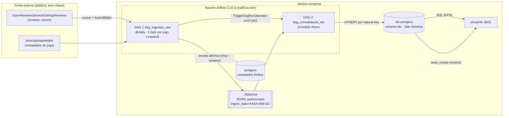

# Arquitetura e decisões de engenharia

## 1. Visão geral



| Serviço | Imagem | Porta host | Persistência |
|---|---|---|---|
| `postgres` | postgres:16 | — | volume nomeado `airflow-db-volume` |
| `dw-postgres` | postgres:16 | 5433 | volume nomeado `dw-db-volume` |
| `airflow-init` | apache/airflow:2.10.5-python3.11 | — | migra o banco e cria o usuário admin, depois termina |
| `airflow-webserver` | idem | 8080 (`AIRFLOW_WEB_PORT`) | — |
| `airflow-scheduler` | idem | — | — |
| `airflow-triggerer` | idem | — | — |
| `streamlit` | `docker/streamlit.Dockerfile` (python:3.11-slim) | 8501 | — |

Bind mounts: `./dags`, `./src` (no `PYTHONPATH`), `./data` (camada raw + staging) e `./logs`.
A conexão do DW é registrada como Airflow Connection `dw_postgres` pela variável de ambiente `AIRFLOW_CONN_DW_POSTGRES`. Assim não há segredo no código e nenhum passo manual na UI.

**Por que a imagem oficial sem Dockerfile próprio para o Airflow?** As DAGs só usam `requests`, `psycopg2` e o provider Postgres, que já vêm na imagem. Evitar `_PIP_ADDITIONAL_REQUIREMENTS` deixa a subida mais rápida e reprodutível. O painel tem dependências próprias (Streamlit, Plotly), então ganhou um Dockerfile leve.

## 2. Fonte de dados e mudança de endpoint

A especificação inicial previa `store.steampowered.com/appreviews/{id}?json=1`. Em 25/11/2026 esse endpoint redirecionava (HTTP 302) para a home da loja, porque foi **descontinuado**. Seguimos o plano: migramos para o substituto oficial, `https://api.steampowered.com/IUserReviewsService/GetAppReviews/v1/`, que também é público e não exige chave. Por ser um *Service interface*, os parâmetros vão em `input_json`:

```json
{"appid": 730, "cursor": "*", "num_per_page": 100, "languages": ["brazilian"],
 "filter": 1, "review_type": 0, "purchase_type": 1}
```

`filter=1` (Recent) é o modo que a documentação recomenda para paginar com cursor, pois a lista termina vazia. O campo `author.num_games_owned` não vem mais nessa API (ver dicionário de dados).

## 3. Resiliência da ingestão (`src/ingestion/steam_client.py`)

| Mecanismo | Implementação |
|---|---|
| Timeout | toda chamada usa `requests.Session.get(..., timeout=30)` |
| Retentativa | até 5 tentativas para **HTTP 429, 500, 502, 503, 504**, `Timeout` e `ConnectionError` |
| Exponential backoff + jitter | espera `min(1s · 2^tentativa, 60s) + U(0, 1)`. O jitter evita que vários workers tentem de novo ao mesmo tempo (*thundering herd*) |
| `Retry-After` | se o servidor enviar o cabeçalho, ele tem prioridade sobre o backoff calculado |
| Erros não recuperáveis | 4xx (exceto 429) e JSON inválido falham na hora (`SteamAPIError`), porque repetir não resolve |
| Polidez | pausa de 1s entre páginas (`STEAM_POLITE_PAUSE`) e no máximo 2 jogos em paralelo (`max_active_tis_per_dagrun=2`) |
| Paginação por cursor | começa com `cursor=*` e repassa o `cursor` devolvido. Para quando a lista vem vazia, o cursor vem nulo, o cursor se repete (proteção contra loop) ou chega a `STEAM_MAX_PAGES` |
| Segunda camada | se o cliente esgotar as tentativas, a task falha e o Airflow refaz a task com `retries=3` e `retry_exponential_backoff=True` |
| Demonstração | `STEAM_SIMULATE_429_RATE=0.2` no `.env` injeta 429 simulados. Os logs da task mostram `[RETRY n/5] ... Aguardando X.XXs (backoff exponencial + jitter)` |

## 4. Idempotência

### DAG 1 — camada Raw

- **Uma partição por dia lógico (`ds`)** e **um arquivo por jogo**: `data/raw/steam_reviews/ingest_date={ds}/app_id={id}.jsonl`.
- A escrita vai para um arquivo temporário no mesmo diretório e depois `os.replace()` (rename atômico) sobrescreve o destino. Rodar de novo o mesmo `ds` (Clear, retry ou trigger manual) **substitui** o arquivo, não acrescenta linhas. Uma falha no meio nunca deixa um arquivo pela metade.
- Deduplicação por `recommendationid` dentro da execução (dict indexado pela chave).
- Evidência: [`prova_idempotencia_dag1.txt`](prova_idempotencia_dag1.txt). Depois do *Clear* das 8 tasks `coletar_reviews`, a partição continua com 16 arquivos e 2.000 linhas únicas por jogo.

### DAG 2 — Data Warehouse

- **Dimensões:** `INSERT ... ON CONFLICT (natural_key) DO UPDATE`. A SK é gerada pelo banco e nunca muda.
- **Fato:** os dados limpos vão para uma tabela temporária `stg_review`. Um `INSERT ... SELECT` faz o lookup das SKs com JOIN nas dimensões pela natural key, com `ON CONFLICT (nk_recommendation_id) DO UPDATE`. A restrição `UNIQUE` torna duplicação fisicamente impossível.
- `RETURNING (xmax = 0)` separa linhas inseridas de atualizadas, e o resultado vai para a `etl_auditoria`.
- A task `validar_integridade` checa FKs órfãs, `nk` duplicada e `qtd_review <> 1`, e falha a DAG se achar algo.
- Evidência: [`prova_idempotencia_saida.txt`](prova_idempotencia_saida.txt), gerada por [`scripts/prova_idempotencia.sh`](../scripts/prova_idempotencia.sh).

## 5. Encadeamento DAG 1 → DAG 2

Escolhemos o **`TriggerDagRunOperator`** (task `disparar_consolidacao_dw`) em vez de Datasets, porque:

1. ele passa o `ds` da ingestão no `conf`, e a DAG 2 sabe exatamente qual partição ler;
2. o vínculo aparece na UI (link da task para a execução disparada), o que ajuda na demonstração;
3. a DAG 2 continua disparável à mão. Sem `ds` no conf, ela usa a partição raw mais recente.

A DAG 2 tem `schedule=None`, ou seja, só roda quando é disparada.

## 6. Passagem de dados entre tasks da DAG 2

XCom guarda só metadados pequenos (caminho do staging, contagens, intervalo de datas). Os registros limpos ficam em `data/staging/ingest_date={ds}/reviews_clean.jsonl`, também com escrita atômica, e cada task de carga lê esse arquivo. Assim o banco de metadados do Airflow não fica sobrecarregado.

## 7. Mecanismo de busca no painel

O Streamlit lê o corpus (`texto_review`) do DW e monta os índices **uma vez** com `st.cache_resource`: BM25, k-gramas e Trie, em cerca de 1 s para 16 mil reviews. Detalhes do algoritmo estão no [README](../README.md#5-inteligência-de-recuperação-de-informação).
