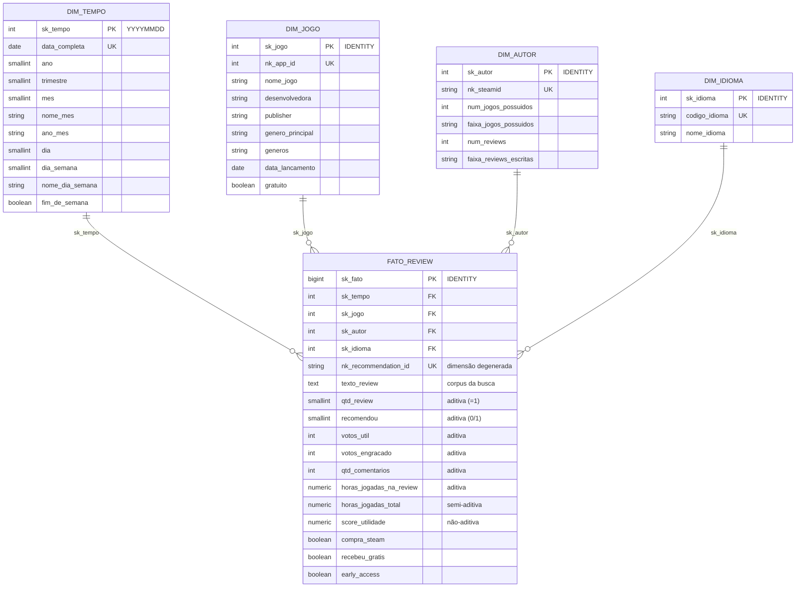

# Modelo Dimensional — Star Schema (Kimball)

Schema `dw` no banco `steam_dw` (contêiner `dw-postgres`, porta 5433 no host).
DDL: [`src/warehouse/ddl.sql`](../src/warehouse/ddl.sql).

## 1. Processo de negócio e granularidade

**Processo de negócio:** publicação de avaliações (reviews) de jogos na Steam.

> **Granularidade da fato:** *cada linha da `fato_review` representa UMA review publicada por um usuário da Steam sobre um jogo, na data de criação da review.*

Consequências da granularidade:

- a chave de negócio da linha é o `recommendationid` da Steam, guardado como **dimensão degenerada** `nk_recommendation_id` (`UNIQUE`). Ela não tem atributos próprios além do texto, então não ganha uma dimensão;
- `qtd_review` vale sempre 1, e `SUM(qtd_review)` conta reviews em qualquer corte;
- a data da linha é a de **criação** da review (`timestamp_created`), não a da coleta.

## 2. Diagrama (Mermaid `erDiagram`)



## 3. Surrogate keys

| Dimensão | SK | Como é gerada | Natural key (fonte) |
|---|---|---|---|
| `dim_tempo` | `sk_tempo` | inteiro `YYYYMMDD` calculado a partir da data | a própria data |
| `dim_jogo` | `sk_jogo` | `INTEGER GENERATED ALWAYS AS IDENTITY` | `nk_app_id` (appid da Steam) |
| `dim_autor` | `sk_autor` | `INTEGER GENERATED ALWAYS AS IDENTITY` | `nk_steamid` |
| `dim_idioma` | `sk_idioma` | `INTEGER GENERATED ALWAYS AS IDENTITY` | `codigo_idioma` |

- A fato referencia **apenas** SKs (FKs com `REFERENCES`). As natural keys ficam nas dimensões, com `UNIQUE`, e servem só para o lookup na carga.
- O UPSERT (`ON CONFLICT (nk) DO UPDATE`) nunca altera a SK de uma linha existente, então as FKs da fato continuam válidas entre execuções.
- `sk_tempo` no formato `YYYYMMDD` é a "smart key" que Kimball recomenda para a dimensão data: é inteira, estável, legível e permite particionar a fato por data. As outras SKs não têm significado de negócio.
- Observação: no PostgreSQL, cada `INSERT ... ON CONFLICT` reserva um valor da sequência IDENTITY mesmo quando vira `UPDATE`. Por isso as SKs podem ter **lacunas** (ex.: `max(sk_autor)` > número de autores). Isso é esperado e não afeta a integridade, já que SK não é contador.

## 4. Dicionário de dados

### `fato_review`

| Coluna | Tipo | Classificação | Descrição |
|---|---|---|---|
| `sk_fato` | bigint | PK técnica | Identificador da linha no DW |
| `sk_tempo` | int | FK → `dim_tempo` | Data de criação da review |
| `sk_jogo` | int | FK → `dim_jogo` | Jogo avaliado |
| `sk_autor` | int | FK → `dim_autor` | Autor da review |
| `sk_idioma` | int | FK → `dim_idioma` | Idioma da review |
| `nk_recommendation_id` | varchar | Dimensão degenerada | `recommendationid` da Steam (`UNIQUE`, chave do UPSERT) |
| `texto_review` | text | Atributo textual | Texto normalizado (corpus do mecanismo de busca) |
| `qtd_review` | smallint | **Aditiva** | Sempre 1. `SUM` = nº de reviews |
| `recomendou` | smallint | **Aditiva** | 1 se o autor recomendou (`voted_up`). `SUM` = nº de recomendações |
| `votos_util` | int | **Aditiva** | Votos "útil" recebidos (`votes_up`) |
| `votos_engracado` | int | **Aditiva** | Votos "engraçado" (`votes_funny`) |
| `qtd_comentarios` | int | **Aditiva** | Comentários na review |
| `horas_jogadas_na_review` | numeric | **Aditiva** | Horas jogadas quando escreveu (minutos / 60) |
| `horas_jogadas_total` | numeric | **Semi-aditiva** | Horas totais do autor no momento da coleta. É um *snapshot* acumulado: somar o mesmo autor ao longo do tempo conta horas em dobro. Some entre autores diferentes, não ao longo do tempo |
| `score_utilidade` | numeric | **Não-aditiva** | `weighted_vote_score` (0–1). Use `AVG`, nunca `SUM` |
| `compra_steam` | boolean | Flag | Comprou o jogo na Steam |
| `recebeu_gratis` | boolean | Flag | Recebeu o jogo de graça |
| `early_access` | boolean | Flag | Review escrita durante o acesso antecipado |
| `criado_em_ts` / `atualizado_em_ts` | timestamp | Auditoria | Timestamps originais (UTC) |
| `carregado_em` | timestamp | Auditoria | Última carga da linha no DW |

**Métrica derivada (não-aditiva):** taxa de recomendação = `SUM(recomendou) / SUM(qtd_review)`. Sempre calcule a razão das somas, nunca a média de taxas já agregadas.

### `dim_tempo`

| Coluna | Descrição |
|---|---|
| `sk_tempo` | SK inteira `YYYYMMDD` |
| `data_completa` | Data (`UNIQUE`) |
| `ano`, `trimestre`, `mes`, `dia` | Partes da data |
| `nome_mes` | Janeiro … Dezembro |
| `ano_mes` | `AAAA-MM`, para agrupar por mês |
| `dia_semana` | 1 = segunda … 7 = domingo (ISO) |
| `nome_dia_semana` | Segunda-feira … Domingo |
| `fim_de_semana` | Sábado ou domingo |

O calendário é gerado **contínuo** (todos os dias, inclusive os sem review) entre a menor e a maior data encontradas na carga.

### `dim_jogo`

| Coluna | Descrição |
|---|---|
| `sk_jogo` | SK (IDENTITY) |
| `nk_app_id` | appid da Steam (`UNIQUE`) |
| `nome_jogo`, `desenvolvedora`, `publisher` | Do endpoint `appdetails` |
| `genero_principal` | Primeiro gênero listado pela Steam |
| `generos` | Todos os gêneros, separados por vírgula (o painel faz `unnest` para analisar por gênero) |
| `data_lancamento` | Data de lançamento (convertida de `4/nov./2020`) |
| `gratuito` | `is_free` |

### `dim_autor` (SCD Tipo 1)

| Coluna | Descrição |
|---|---|
| `sk_autor` | SK (IDENTITY) |
| `nk_steamid` | SteamID64 (`UNIQUE`) |
| `num_reviews` / `faixa_reviews_escritas` | Nº de reviews que o autor já escreveu, e a faixa (1, 2-5, 6-20, 21-100, 100+) |
| `num_jogos_possuidos` / `faixa_jogos_possuidos` | Nº de jogos na biblioteca e a faixa (0-10, 11-50, 51-200, 200+). A API atual (`IUserReviewsService`) deixou de devolver esse campo, então ele fica nulo e a faixa vira "Não informado". A coluna foi mantida para compatibilidade com a fonte |

Atributos do autor mudam com o tempo. Optamos por **SCD Tipo 1** (sobrescrever com o valor mais recente), porque a análise de interesse é o perfil atual.

### `dim_idioma`

| Coluna | Descrição |
|---|---|
| `sk_idioma` | SK (IDENTITY) |
| `codigo_idioma` | Código da Steam (`brazilian`, `english`…) |
| `nome_idioma` | Nome em português |

A coleta filtra `brazilian`, então hoje existe 1 linha. A dimensão já atende se a lista de idiomas aumentar (`STEAM_LANGUAGE`).

### `etl_auditoria` (tabela técnica, fora do star schema)

`dag_id`, `run_id` (`UNIQUE` com `dag_id`), `ds`, `linhas_lidas`, `linhas_inseridas`, `linhas_atualizadas`, `inicio`, `fim`, `status` (`success`, `loaded`, `integrity_failed`) e `detalhes` (JSONB com estatísticas de limpeza, por dimensão e resultado das checagens de integridade). O painel lê essa tabela na aba de Engenharia.

## 5. Exemplos de consultas analíticas

```sql
-- Taxa de recomendação por jogo e trimestre
SELECT j.nome_jogo, t.ano, t.trimestre,
       SUM(f.qtd_review) AS reviews,
       ROUND(100.0 * SUM(f.recomendou) / SUM(f.qtd_review), 1) AS pct_recomendacao
FROM dw.fato_review f
JOIN dw.dim_jogo  j USING (sk_jogo)
JOIN dw.dim_tempo t USING (sk_tempo)
GROUP BY 1, 2, 3 ORDER BY 1, 2, 3;

-- Reviews negativas no fim de semana vs. dias úteis
SELECT t.fim_de_semana, SUM(f.qtd_review) - SUM(f.recomendou) AS negativas
FROM dw.fato_review f JOIN dw.dim_tempo t USING (sk_tempo)
GROUP BY 1;
```
